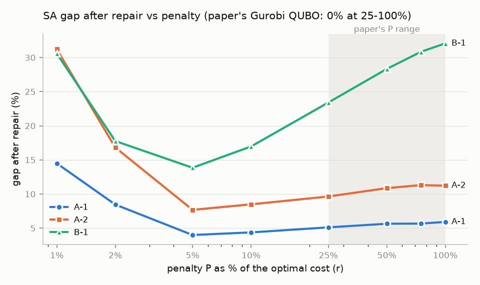
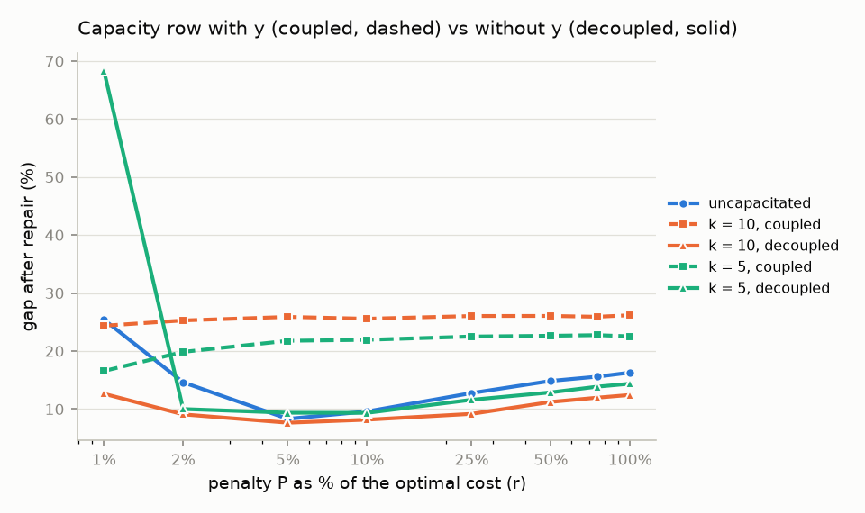

# QUBO penalty study for the uncapacitated facility location problem

A small, reproducible computational study built on

> Li, H., Hennig, R., Kochenberger, G., & Glover, F. (2026). Quantum bridge analytics: a QUBO
> approach to the uncapacitated facility location problem. *Annals of Operations Research*.
> https://doi.org/10.1007/s10479-026-07201-1

The paper reformulates the uncapacitated facility location problem (UFLP) as a QUBO by moving its
constraints into the objective with a penalty P. It found that P = 25–100% of the optimal cost works
when the QUBO is solved with Gurobi's QUBO solver.

**Question 1:** does the choice of P behave the same when the QUBO is solved by classical
**simulated annealing (SA)**?
**Question 2:** can a model predict a good P for a new instance from cheap features, without knowing
the optimal cost?

A short overview of the whole study: [`report/study_summary.pdf`](report/study_summary.pdf).

All results here are from classical simulated annealing. They are not quantum results and not
Gurobi results.

## Main findings so far

On the paper's OR-Library instances (classes A-1, A-2, B-1: 37 files = 12 distinct problems), with
2,960 seeded SA runs (full write-up: [`report/m3_summary.md`](report/m3_summary.md)):

| | A-1 | A-2 | B-1 |
|---|---|---|---|
| SA gap at the paper's P = 50% (raw, as measured in the paper) | 56.6% | 80.1% | 109.6% |
| SA gap at P = 50% after repair | 5.6% | 10.9% | 28.3% |
| SA gap at its best P = 5%, after repair | **4.0%** | **7.7%** | **13.9%** |
| Paper, Gurobi QUBO solver, P = 25–100% | 0% | 0% | 0% |

1. **The best penalty depends on the solver.** For single-flip SA it is about 5% of the optimum, well
   below the paper's range. Across the paper's 25–100%, SA gets steadily worse as P grows.
2. **The paper's "no infeasibility at 25%" has a simple explanation.** The QUBO minimum is guaranteed
   feasible once P > max(max_j min_i (f_i + c_ij), max_i f_i). That is 16.6–22.6% of the optimum on these
   instances, so every QUBO in the paper's range is exact (`uflp.qubo.penalty_bounds`).
3. **More SA effort does not close the gap** (10× sweeps gain < 2 points), which is consistent with
   energy barriers of size about P.



**Question 2** (full write-up: [`report/m5_summary.md`](report/m5_summary.md)). I generated 200 seeded
instances in four families, one with a large LP gap, and ran 7,200 SA runs at P = r × LP bound. The
best r is always 2–6%. I then trained an XGBoost regressor on cheap, scale-free features:

| Mean repaired gap % | model | best fixed r | 50% of LP (paper) | oracle |
|---|---|---|---|---|
| 5-fold CV, 200 instances | **1.69** | 2.94 | 42.3 | 1.30 |
| large-gap family held out | **6.70** | 45.18 | 46.0 | 2.29 |
| ORLIB (sanity check) | 9.91 | **8.15** | 14.95 | 7.73 |

The model helps within the training distribution and on the held-out large-gap family, but it does
not transfer to ORLIB, and it mostly separates families rather than instances.

**Why not ORLIB?** ORLIB's customer demands are heavy-tailed (one customer holds 22% of all demand),
which put it outside the training data. Adding a heavy-demand family narrowed the shortfall
(9.91% → 9.14%), but did not close it. The remaining reason is that ORLIB's gap-vs-P curve is flat
from 4% to 15%, while the synthetic curves are steep. See the last section of
[`report/m5_summary.md`](report/m5_summary.md).

## Extension: capacitated facility location

Full write-up: [`report/capacitated_summary.md`](report/capacitated_summary.md). The capacitated
model of Li (2026, *Urban Lifeline*, Appendix A) is written as a QUBO with binary slack variables.
The exact MILP reproduces all seven optimal values of that paper's Table 3. On ORLIB costs with at
most k customers per facility:

| best mean repaired gap (12 problems) | k = 5 | k = 10 |
|---|---|---|
| capacity row Σx + s = k·y (as written) | 16.6% | 24.4% |
| capacity row Σx + s = k (equally exact) | **9.4%** | **7.7%** |
| uncapacitated, same problems | 8.3% | 8.3% |

With y in the capacity row, closing a facility costs k²·P in one flip, so SA keeps every facility
open. Writing the row without y removes that barrier. Separately, binary slack encodings create
barriers of their own, so at k = 10 few raw reads are feasible.



## Reproduce

Requires Python 3.12 or 3.13.

```bash
python -m venv .venv
.venv/Scripts/python -m pip install -r requirements.txt -e .   # on Linux/macOS: .venv/bin/python
python data/download.py                    # 37 ORLIB files + uncapacitated optima (checked)
pytest -q                                  # 135 tests, including both papers' worked examples
python scripts/verify_milp_optima.py       # M1: exact MILP matches all 37 published optima
python scripts/run_reproduction.py         # M3: 2,960 SA runs (about 1 h on 6 cores)
python scripts/verify_m3_results.py results/reproduction_<timestamp>.csv
python scripts/make_figures.py results/reproduction_<timestamp>.csv
python scripts/make_labels.py instances    # M4: 200 synthetic instances, solved exactly
python scripts/make_labels.py instances --design heavy                     # + 50 heavy-demand instances
python scripts/make_labels.py runs results/ml_instances_<ts>.csv           # 7,200 SA runs (~2 h)
python scripts/make_labels.py runs results/ml_instances_heavy_<ts>.csv     # 1,800 SA runs
python scripts/verify_labels.py results/ml_instances_<ts>.csv results/ml_runs_<ts>.csv
python scripts/run_orlib_check.py          # M5: 600 extra ORLIB runs
python scripts/train_penalty_model.py \
    --instances results/ml_instances_<ts>.csv results/ml_instances_heavy_<ts>.csv \
    --runs results/ml_runs_<ts>.csv results/ml_runs_<ts2>.csv \
    --m3-runs results/reproduction_<ts>.csv --orlib-extra results/orlib_extra_<ts>.csv
python scripts/run_capacitated.py          # capacitated, coupled row (960 runs, ~2 h)
python scripts/run_capacitated.py --formulation decoupled --seeds 3     # 576 runs
python scripts/analyze_capacitated.py results/capacitated_<ts>.csv results/reproduction_<ts>.csv
python scripts/compare_capacitated_forms.py results/capacitated_<ts>.csv \
    results/capacitated_decoupled_<ts>.csv results/reproduction_<ts>.csv
```

Every run is seeded; results go to timestamped files in `results/` and are never overwritten.

## Layout

| Path | What it is |
|---|---|
| `data/download.py` | downloads instances and optima, with consistency checks |
| `src/uflp/io.py` | OR-Library parser (costs are stored per customer, so it transposes them) |
| `src/uflp/milp.py` | exact solve and LP relaxation (PuLP + HiGHS) |
| `src/uflp/qubo.py` | the paper's two QUBO constructions (eq. 15 and Properties 1–2), exactness bounds |
| `src/uflp/anneal.py`, `repair.py` | seeded SA runner; repair to a feasible solution |
| `src/uflp/experiment.py` | one run → one CSV row |
| `src/uflp/generate.py`, `heuristics.py`, `features.py` | synthetic instances, greedy heuristic, ML features |
| `src/uflp/ml.py` | labels, penalty rules, evaluation, bootstrap CIs |
| `src/uflp/capacitated.py` | capacitated variant: exact MILP, QUBO with slack (coupled/decoupled), SA, repair |
| `scripts/` | the M1–M5 pipelines, checks, figures and the summary PDF build |
| `results/`, `report/` | outputs and write-ups |

## Differences from the paper

- Simulated annealing (`dwave-samplers`, 50 reads × 1,000 sweeps) instead of Gurobi's QUBO solver,
  D-Wave's hybrid solver or NGQ.
- Classes A-1, A-2 and B-1 only; synthetic instances for the ML part.
- Quality is reported both raw (as in the paper) and after a repair step that the paper did not need.
- Timing is SA CPU time, not the paper's time to the best solution, so the two are not directly comparable.

## Data sources

- OR-Library (J. E. Beasley): https://people.brunel.ac.uk/~mastjjb/jeb/orlib/uncapinfo.html
- Uncapacitated optima for the capacitated-set files: the UflLib ORLIB package (M. Hoefer, MPI
  Informatik). UflLib was unreachable in November 2026, so a pinned GitHub copy is used and checked
  three ways (see `data/download.py`).
