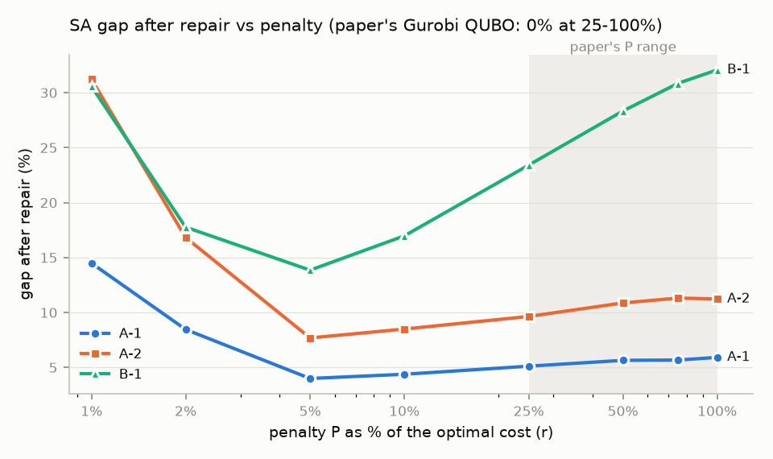

# How should the penalty be chosen when the UFLP QUBO is solved by simulated annealing?

*A short computational study building on Li, Hennig, Kochenberger & Glover (2026), "Quantum bridge
analytics: a QUBO approach to the uncapacitated facility location problem", Annals of Operations
Research.* Prepared by Moneet, November 2026. All results are from classical simulated annealing;
none are quantum or Gurobi results.

## 1. Question

The paper reformulates the uncapacitated facility location problem (UFLP) as a QUBO (eq. 15) with
a penalty P. With Gurobi's QUBO solver it found that P = 25–100% of the optimal cost always gave the
optimum on the ORLIB classes, and it chose 50%. I asked two questions:

1. **Does the choice of P behave the same when the QUBO is solved by single-flip simulated annealing (SA)?**
2. **Can a good P be predicted for a new instance from cheap features, without the optimum?**

## 2. Setup

- **Model.** Both constructions in the paper: eq. 15 built algebraically, and the Q matrix from
  Properties 1–2. They give the same matrix on all 37 files. Both reproduce the appendix example
  entry for entry, including the −710 + 1,000 = 290 result.
- **Instances.** Classes A-1, A-2 and B-1 (37 ORLIB files). Two points about this data:
    - the capacitated-set files (cap4x, 5x, 6x, 8x, 9x, 11x, 12x) have the same fixed and service costs
      as cap7x, 10x and 13x, so the 37 files are **12 distinct uncapacitated problems**; I average over
    distinct problems;
    - an exact MILP solve (HiGHS) reproduces all 37 published optima, and **the LP relaxation's optimal
      solution is already 0/1 on every file**, so the LP bound equals the optimum.
- **Solver and grid.** SA from `dwave-samplers` (50 reads × 1,000 sweeps, default schedule), 10 seeds
  per file. P = r × optimum, with r ∈ {1, 2, 5, 10, **25, 50, 75, 100**}% (the paper's values in bold);
  2,960 runs in total.
- **Quality.** Gap = (cost − opt)/opt. I report it two ways:
    - **raw:** the best feasible read, as in the paper;
    - **repaired:** keep the facilities a read opens and assign each customer to its cheapest open one.

## 3. Findings

**(a) Why the paper saw no infeasibility at 25%.** A short argument gives bounds on the smallest
"exact" P, meaning the smallest P at which every minimizer of the QUBO is feasible, and hence optimal:

- *Sufficient:* P &gt; max( maxj mini (fi + cij), maxi fi ). Above this, every infeasible state
  has a strictly improving move: serve a dropped customer, remove a duplicate assignment, or open a
  facility that is serving customers.
- *Necessary:* P ≥ maxj mini cij, and P ≥ opt/|J|.

On the toy example the exact threshold is 72.5 = opt/|J|. On the 12 ORLIB problems the sufficient
bound is **16.6–22.6% of the optimum**, so every QUBO in the paper's 25–100% range was provably exact.
SA agrees: at 25–100% the best read of all 1,480 runs is feasible, while no read below 25% is feasible.

**(b) For SA, the paper's range is the wrong place to look.**

| Mean gap % (12 problems) | A-1 | A-2 | B-1 |
|---|---|---|---|
| raw, at P = 50% (as measured in the paper) | 56.6 | 80.1 | 109.6 |
| repaired, at P = 50% | 5.6 | 10.9 | 28.3 |
| repaired, at **P = 5%** (SA's best) | **4.0** | **7.7** | **13.9** |
| paper, Gurobi QUBO solver, P = 25–100% | 0 | 0 | 0 |

- The repaired gap is lowest at P = 5% for 10 of the 12 problems. That is below the exactness
  threshold: SA's raw reads are infeasible there, but the facilities they open are good.
- Across 25–100%, SA gets steadily worse as P grows, whereas Gurobi's solution quality did not depend
  on P on these classes.
- **More effort does not fix this.** Ten times more sweeps on cap74 improved the repaired gap by at
  most 1.6 points, and not at all at P ≥ 25%. This is consistent with energy barriers of size about P:
  moving one customer between facilities passes through a state that costs about P.
- **What makes an instance hard differs by solver.** Although every file has a zero LP gap, SA
  struggles most where fixed costs are high and few facilities are open (cap74, cap104 and cap134,
  with 4 open). On B-1 at P = 50%, the gap ranges from 13.6% (cap131) to 45.7% (cap134).

**(c) A good penalty depends on the solver, and here on the instance too.** I generated 200 seeded
instances in four families, 16–50 sites × 50 customers. Three resemble ORLIB (LP gap ≈ 0). The fourth
is modelled on the Kochetov–Ivanenko construction behind class B-2, and has LP gaps of 1.3–26%. Each instance
was solved exactly, then by SA at 12 values of P = r × LP bound (7,200 runs). The best r is always
2–6%, but fixed rules fail unevenly:

| Mean repaired gap % | best r per instance | fixed 3% | fixed 4% | 50% of LP | 100% of LP |
|---|---|---|---|---|---|
| all 200 instances | 1.30 | 12.22 | 2.94 | 42.3 | 48.7 |
| large-gap family only | 2.29 | 45.18 | 6.70 | 46.0 | 51.9 |

A fixed 3% is nearly optimal on the three ORLIB-like families but costs 45% on the large-gap family.
I trained a gradient-boosted regressor on log r\* using ten scale-free features, none of which uses
the optimum: the greedy–LP gap, the exactness bounds relative to LP, cost dispersion, and others.
The results are mixed:

- **5-fold cross-validation:** a mean gap of 1.69%, against 2.94% for the best fixed r (paired 95% CI
  of the difference [0.86, 1.67]) and 1.30% for the oracle.
- **Large-gap family held out from training:** 6.7% against 45.2% for the best fixed rule. A simple
  rule, r = k × (exactness bound)/LP, does about as well here.
- **ORLIB:** it does not transfer; it is 1.8 points worse than a fixed 4%. Its predictions mostly
  separate families rather than instances.

The robust lesson is the scale: for SA, a good P is a few percent of the LP bound, and the 50% that
suits Gurobi costs 30–52 points of gap.

## 4. Limitations and notes

- **Classical SA only, at one setting.** Nothing here is evidence about quantum annealing, D-Wave's
  hybrid solver or Gurobi. The repair step is mine; the paper needed none. SA's CPU time is not
  comparable with the paper's time to the best solution.
- **Instances.** ORLIB's LP bound equals its optimum, so it cannot test an estimate-based rule on its
  own; hence the synthetic large-gap family. B-2 was not run, because UflLib was unreachable.
- **An implementation note on Property 2.** Read literally, the index formula
  min{|I| + m·|J| + j, |I|(|J|+1)} for m = i, …, |I| clamps to the last variable when m = |I|. On the
  appendix example that places extra 2P entries in the x₃₄ column. I built the matrix from the
  property's description (pairs i < i′ for the same customer), which reproduces the appendix matrix
  exactly.
- **Reproducibility.** Every run is seeded and logged. A test suite (111 tests) covers the appendix
  example, all 37 optima and both constructions. The code and data are in a GitHub repository that I
  can share.
